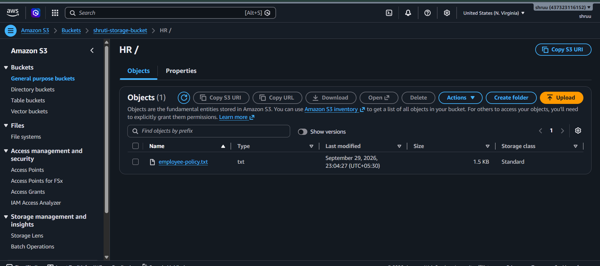
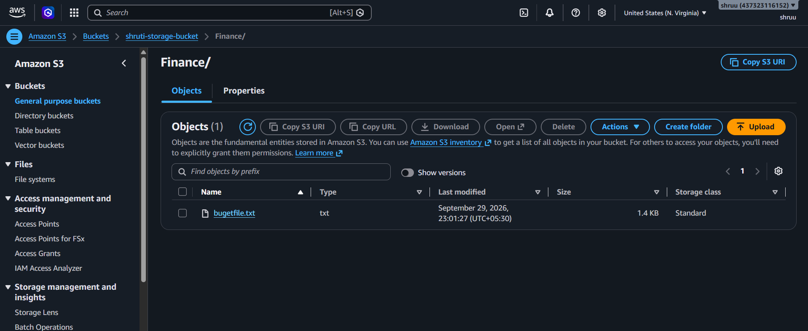
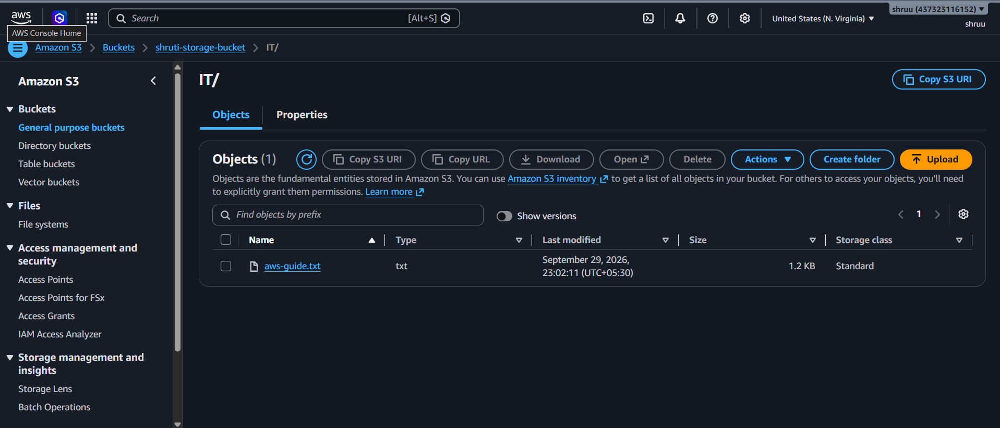
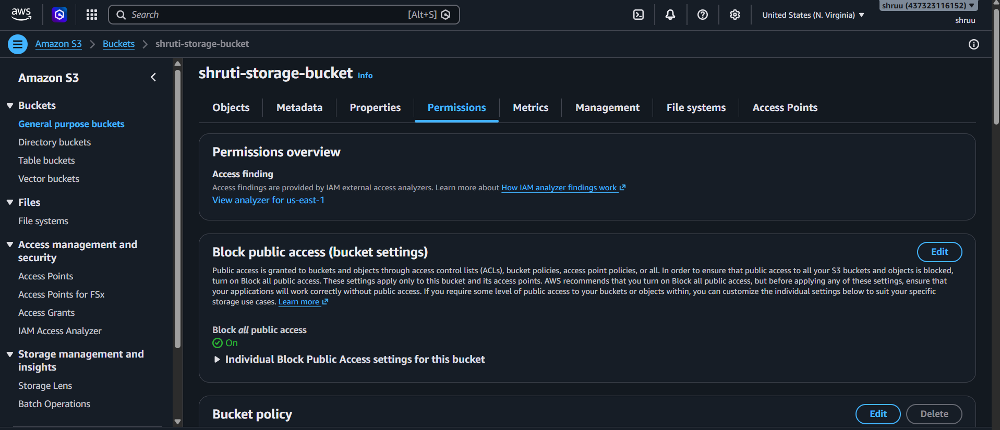
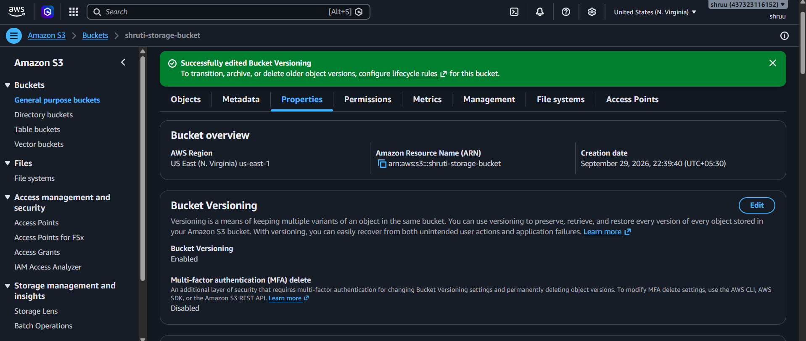
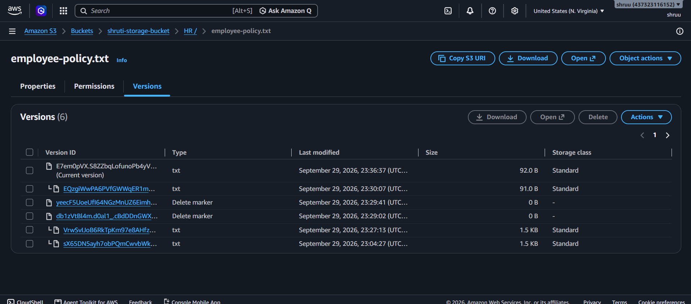

# Amazon S3 Document Storage System

## Project Overview

In this project, I created an Amazon S3 based document storage system for an organization.

The main purpose of this project was to store documents in an organized way, configure secure bucket access, enable versioning, and recover an earlier version of a file.

## AWS Service Used

* Amazon S3

## Project Objectives

* Create an S3 bucket for document storage
* Organize documents using folders
* Configure bucket access permissions
* Keep the bucket private
* Enable S3 Versioning
* Upload multiple versions of the same file
* Recover an earlier version of a file

---

## Step 1: Create S3 Bucket

I created an S3 bucket for storing organization documents.

**Bucket Name:**

```text
shruti-organization-document-storage
```

**Region:**

```text
Asia Pacific (Mumbai) - ap-south-1
```

I kept the bucket private and kept **Block Public Access** enabled.

### Screenshot


---

## Step 3: Upload Documents

I created sample documents on my local computer and uploaded them to the appropriate folders.

The documents were organized as follows:

```text
HR/
└── employee-policy.txt

Finance/
└── budget.txt

IT/
└── aws-guide.txt
```

### Screenshot

HR/


Finance/


IT/


---

## Step 4: Configure Bucket Access

I kept **Block Public Access** enabled so that the organization documents are not publicly accessible.

The bucket was kept private and access can be controlled using AWS IAM permissions.

### Access Configuration

```text
Block Public Access: Enabled
Bucket Access: Private
ACLs: Disabled
```

### Screenshot



---

## Step 5: Enable Versioning

I enabled S3 Bucket Versioning from:

```text
S3 → Bucket → Properties → Bucket Versioning
```

Versioning allows S3 to maintain multiple versions of the same object.

### Screenshot



---

## Step 6: Upload Version 1

I uploaded the file:

```text
employee-policy.txt
```

inside the `HR` folder.

The first version contained:

```text
Employee Policy
Version 1

Working hours: 9 AM to 6 PM.
Leave policy: 12 days per year.
```

Since versioning was enabled, S3 stored this file as a version of the object.

---

## Step 7: Upload Version 2

I modified the same `employee-policy.txt` file.

The updated content was:

```text
Employee Policy
Version 2

Working hours: 10 AM to 6 PM.
Leave policy: 15 days per year.
```

I uploaded the modified file again using the same file name.

Because versioning was enabled, S3 kept the previous version and created a new version.

The version history was:

```text
employee-policy.txt

Version 2 → Current Version
Version 1 → Previous Version
```
---

## Step 8: Recover Earlier Version

I enabled **Show versions** in the S3 folder and viewed the previous versions of `employee-policy.txt`.

I selected the older version and downloaded it to recover the Version 1 file.

The recovered file contained the original Version 1 information.

### Screenshot



---

## Final S3 Structure

```text
shruti-organization-document-storage
│
├── HR/
│   └── employee-policy.txt
│       ├── Version 1
│       └── Version 2
│
├── Finance/
│   └── budget.txt
│
└── IT/
    └── aws-guide.txt
```

---

## Features Demonstrated

* Created an Amazon S3 bucket
* Created department-wise folders
* Uploaded documents
* Configured private bucket access
* Enabled Block Public Access
* Enabled S3 Versioning
* Uploaded multiple versions of a file
* Viewed previous versions
* Recovered an earlier version of a file

---

## What I Learned

Through this project, I learned how Amazon S3 can be used to store and organize documents.

I also learned how to keep an S3 bucket private and control access to the stored data.

The main concept I practiced was **S3 Versioning**. It helps to keep previous versions of a file and allows an older version to be recovered if the current file is accidentally changed or overwritten.

---

## Conclusion

I successfully created an Amazon S3 based document storage system with organized folders, secure bucket access, versioning, and recovery of an earlier version of a document.

This project helped me understand the practical use of Amazon S3 for document storage and data protection.

---

## Author ##
* SHRUTI MORE 